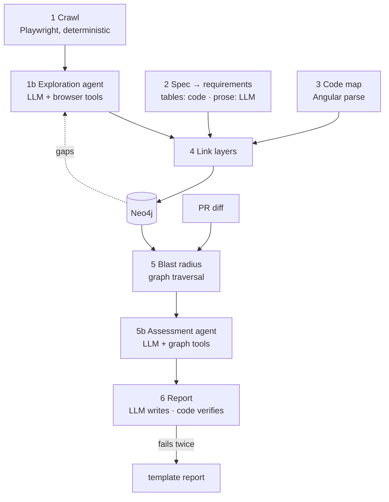
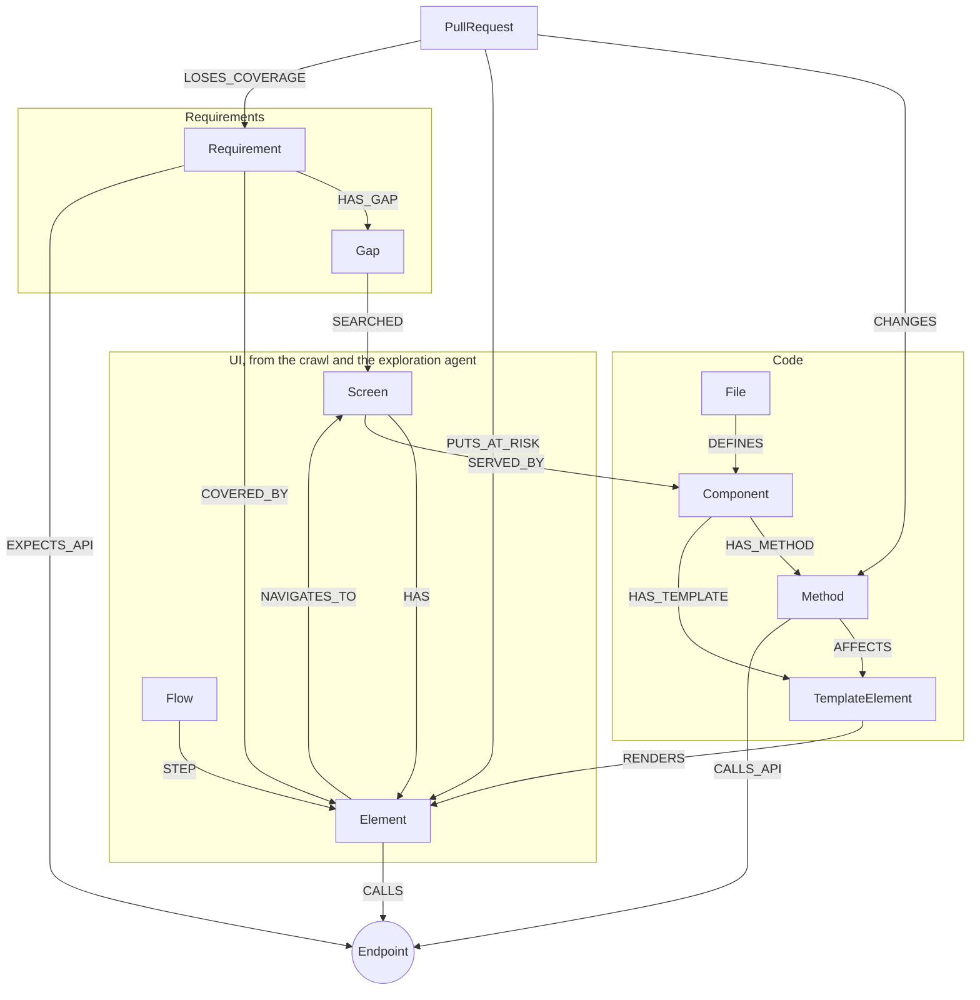

# Blast radius: design document

**Nekender Shekhawat · Testsigma AI Engineer assignment · November 2026**

## 0. What I built, in one page

An agent that answers one question for a QA lead: **"what could this pull request break, and how sure are you?"**

The design in one sentence: **a grounded graph of the app (what the spec says, what the UI shows, what the code
does), with LLM agents on top where judgment is needed: exploring what the crawl can't reach, and reasoning about
what a change actually does.** Everything an agent concludes is checked against the graph before it reaches a report.

It works on [Conduit](https://demo.realworld.show), the RealWorld demo app (Angular frontend), because it is the rare
public app with all three layers tied together: a live deployment, the
[source repo](https://github.com/realworld-apps/angular-realworld-example-app) that deploys it, and a public spec that
**enumerates** what the app must contain (the [frontend spec](https://docs.realworld.show/specifications/frontend/routing/)
plus an E2E [selectors contract](https://github.com/realworld-apps/realworld/blob/main/specs/e2e/SELECTORS.md)). An
enumerated spec matters: you can only claim something is *absent* if you know what should be there.

| Layer | Source | What the graph holds today |
|---|---|---|
| Requirements | spec tables (code) + routing prose (LLM) | 106 requirements: 100 covered, 6 unknown (each with a reason) |
| UI | Playwright crawl (logged out, logged in) + exploration agent (as a content owner) | 16 screens, 252 elements, 10 user journeys, all observed |
| Code | Angular-aware parse of the repo at any commit | 11 routes, every component method with line ranges, 24 service endpoints |
| Code ↔ UI | scored matching + an independent API-call check | 216 of 252 elements linked to the template that renders them |

**Sample output:** [`reports/pr-311.md`](../reports/pr-311.md). PR #311 changes how the editor saves an article. The
assessment agent read the diff and says what changed in behaviour: *editing an existing article now sends PUT; creating
one still sends POST.* The report ranks **"Edit your own published article"** first (observed in the running app,
because the exploration agent created an article, opened it as its author and reached the edit page), then the create
path as a regression check, and lowers journeys that only use the editor as a setup step.

**Where I went deep:** the **code ↔ UI link**, **requirements ↔ UI including absence**, and **two guarded agents**
that close the gaps the deterministic parts leave. **Where I scoped down:** code parsing (regex + HTML parser, Angular
only), one app, and write-gated states beyond article ownership. Section 5 defends each cut.

**Evals:** on two hand-labelled PRs, the deterministic stages give byte-identical output across runs, recall is 1.0,
every LLM report passed verification, and the assessment agent put the right journey first in every run with no
ungrounded adjustments. Section 4 explains why that is weaker evidence than it looks.

## 1. Agent decomposition



The rule for every boundary: **deterministic where the answer is a fact in the code or the app; an LLM where the task
needs judgment or reads prose; and every LLM output checked by code before it counts.**

| Stage | Who decides | Why |
|---|---|---|
| 1 Crawl | Code | The ground everything stands on. If it varied run to run, nothing downstream would be reproducible or evaluable. |
| 1b Explore | **LLM agent** with browser tools | Some states need a plan, not breadth-first search: "to see the author's Edit button, first publish an article, then open it". The agent reads the open gaps and decides how to reach them. |
| 2 Spec | Code for tables, LLM for prose | SELECTORS.md is tables (89 requirements): no reason to pay a model to read a table. Routing prose becomes requirements **with the UI evidence that would prove them**, schema-constrained. |
| 3 Code map | Code | Routes, methods, bindings and line ranges are facts; diff mapping needs them exact. |
| 4 Link | Code (scored); LLM judge only for evidence-free requirements | Matching a crawled button to its template is a scoring problem with good features. |
| 5 Blast radius | Code | What is *connected* to the changed code is a graph fact. This is the safety floor. |
| 5b Assess | **LLM agent** with graph tools | What the change *does* is judgment: PR #311 touches `submitForm`, but only the edit branch changed behaviour. The agent reads the diff and the code, inspects impacts, and re-ranks them. |
| 6 Report | LLM writes, code verifies | A QA lead needs prose. Every bullet cites fact ids; invented ids or a dropped high-confidence item fail the check. |

**Why these are agents and not prompt chains.** Both run a real tool loop (`llm.agent_loop`): the model chooses which
tool to call next, sees the result, and decides when it's done. The tools are ours, so every action is something our
code implements and can refuse. Each agent has a trace saved with its output, so a run can be replayed and evaluated on
its trajectory, not just its answer.

### 1b · The exploration agent

The crawl left requirements like "Delete Article is shown only to the article's author" as *unknown*: the crawler
never owned an article. The agent gets those gaps as goals and four tools: `observe` (URL, login state, numbered
controls), `click`, `fill`, `goto`. In the run in the repo it took 8 tool calls: open the editor, write a test
article, publish it, open it as the author, click Edit. Every new page it reaches as an owner is recorded like a
crawled page, in a separate tab with all writes blocked, so the dry-run clicks there tell us that the owner's Publish
button sends `PUT /api/articles/:slug`.

**Guardrails, in code, not in the prompt:**
- **Write policy.** The only writes that pass are creating *one* article whose title starts with `br-test:` and
  deleting articles this run created. Everything else is aborted at the network layer and reported back to the agent
  as blocked. (Writing to the live demo was approved for this single article.)
- **Cleanup.** Every article it created is deleted through the API in a `finally`, and the deletion is checked (the
  article must return 404). Leftover test articles from a crashed run are deleted at the start of the next one.
- **Honest finish.** It reported what it could not reach (the comment-delete controls need a posted comment, which the
  policy blocks), and those requirements stay *unknown* with that reason.

Result: 8 requirements moved from unknown to covered (92 → 100), the edit and delete journeys became observed, and the
"stitched from code" placeholder for the edit flow is no longer needed.

### 5b · The assessment agent

Tools: `read_diff`, `method_source`, `impacts`, `inspect` (a flow's steps and calls, a requirement's evidence, a
control's calls and the template that renders it). It finishes with a behaviour summary, confidence adjustments with
reasons, and a re-test order.

**Guardrails:**
- It can only adjust impacts that exist, and only ones it has **inspected**. If it adjusts something it never
  looked at, the verifier sends it back once ("inspect these, then resubmit"); anything still ungrounded is rejected.
- Changes are **bounded**: floor 0.3, at most 0.5 per assessment (capped, not vetoed), and nothing unobserved can go
  above 0.9. **Nothing is ever removed**, so the deterministic result stays the floor: the agent can reorder risk,
  never hide it.

On PR #311 it wrote: *"submitForm now reads the route slug. With a slug it calls update (PUT). Without one it still
calls create (POST). Before, every submit called create, so editing an existing article sent a POST."* It raised the
edit journey, lowered the create journey to a regression check, and lowered "Delete your own article", which only uses
the editor to set up the article it deletes.

### Crawler decisions worth defending

- **Dry-run clicks.** Every button is clicked with all non-GET calls aborted, so we learn which API each control calls
  without writing to a public app. That observed call is an independent signal for linking code to UI.
- **Journeys, not single clicks.** A flow is the shortest observed path to an action that changes data, with the
  inputs in that action's form, starting from sign-in; owner journeys follow the exploration agent's own path. The LLM
  names them ("Edit your own published article"); each name is checked (real flow, short, unique) or a plain name is used.
- **It checks it is logged in, on every page.** The demo resets its data, which once silently logged out the test
  account and turned the "logged-in" crawl into a second logged-out one: coverage fell from 92 to 67 with no error.
  Now the session is verified first (saved token, then saved login, then a new account) and every logged-in page is
  checked against the app's own auth state; a mismatch stops the crawl.
- **State identity = route template + login state** (anon, authed, owner). Templates are learned from URLs; each is
  visited at most twice, so 500 articles are one screen.

Both pipelines are LangGraph graphs (`pipeline.py`). The spec and code stages run in parallel; the reason graph is
*analyse → assess (agent) → write → verify → rewrite once or fall back*, with the verify branch as an explicit
conditional edge. I used LangGraph for named, typed stages and that loop; the agents' own tool loops are plain code,
so their traces are simple to save and replay.

## 2. Graph schema, and why



The same schema as text, with edge properties:

```
Requirements  (Requirement)-[:COVERED_BY {confidence, method, evidence}]->(Element | Screen)
              (Requirement)-[:HAS_GAP]->(Gap {status, reason})-[:SEARCHED]->(Screen)
              (Requirement)-[:EXPECTS_API]->(Endpoint)
UI            (Screen {template, auth: anon|authed|owner})-[:HAS]->(Element)-[:NAVIGATES_TO]->(Screen)
              (Element)-[:CALLS {observed}]->(Endpoint)      (Screen)-[:LOADS]->(Endpoint)
              (Flow)-[:STEP {order}]->(Screen | Element | TemplateElement)
Code          (File)-[:DEFINES]->(Component)-[:HAS_METHOD]->(Method)-[:CALLS_API]->(Endpoint)
              (Component)-[:HAS_TEMPLATE]->(TemplateElement)
              (Method)-[:AFFECTS {why}]->(TemplateElement)
Code ↔ UI     (TemplateElement)-[:RENDERS {confidence, method, evidence}]->(Element)
              (Screen)-[:SERVED_BY]->(Component)
PRs           (PullRequest)-[:CHANGES]->(Method)
              (PullRequest)-[:PUTS_AT_RISK {confidence, why, observed}]->(Element | Flow | Requirement | ...)
              (PullRequest)-[:LOSES_COVERAGE {why}]->(Requirement)
```

**Justified against the query I actually run.** The blast radius is one traversal:

> changed `Method` → `AFFECTS` → `TemplateElement` → `RENDERS` → `Element` ← `HAS` ← `Screen`;
> then `Flow`s with a `STEP` on those elements; then `Requirement`s whose `COVERED_BY` points at them.

1. **`TemplateElement` sits between `Method` and `Element`.** A method doesn't render anything; it is bound to markup
   (`(click)="submitForm()"`), and markup renders into the page. That hop is what lets a report say *why* a button is
   at risk ("bound to `submitForm()`; matched on screen by text and by the API call it made").
2. **`Endpoint` is shared by all three layers.** Code calls it, the UI was seen calling it, the spec expects it. That
   is a second path from a change to a requirement, independent of the crawl.
3. **Confidence lives on edges.** A button isn't uncertain; the link to it is. Path confidence = product of edges.
4. **Login state is part of a screen's identity,** including **owner**. "The editor as the article's author" is a
   different screen from "the editor for a new article", and requirements say which state they need.
5. **The graph is also the agents' memory and their check.** The exploration agent's goals come from `Gap` nodes;
   the assessment agent can only adjust items that exist in it. Each analysed PR is written back as a `PullRequest`
   node, so "which PRs touch the sign-in journey?" is one query.

### Absence

**Absence is a node, not a missing edge.** "No `COVERED_BY` edge" can't distinguish *absent* from *we never looked*.
A `Gap` records where we looked (`SEARCHED` edges to screens, with their login state) and a status:

| Status | Meaning | Example from this app |
|---|---|---|
| `absent` | Crawled the right page in a state that should show it; nothing matched; **not in the code either** | none on this app |
| `unknown` | Never reached in the needed state, or present in code behind a condition the crawl and agent never met | comment-delete controls: need a posted comment, which the write policy blocks |
| `unknown` (write-gated) | Code can make the call, but the triggering state needs a prior write | "Unfollow" needs a user you already follow |
| partly present | Some evidence pieces found, others missing | below |

**Gaps are also a work queue.** An `unknown` is a question the system can try to answer: the exploration agent turned
8 of them into covered requirements. What remains is either behaviour with no UI evidence (JWT storage) or a state the
write policy deliberately doesn't create.

My first version reported 7 requirements as absent; checking each by hand showed all 7 were wrong (a crawler bug, a
spec-parser bug, and two write-gated calls). So **absence needs three facts: the page was crawled, in a state that
should show it, and the code doesn't have it either.**

**Partial presence found real spec drift,** confirmed in the source: profile tabs say "My Posts / Favorited Posts"
(spec: "My Articles / Favorited Articles"); the settings placeholder is "Username" (spec: "Your Name"); the home banner's
tagline "A place to share your knowledge." is gone. A green test run wouldn't catch any of these.

## 3. Confidence under ambiguity

Every link and impact carries a confidence and the evidence behind it, in words. Thresholds: **≥ 0.75 accept**,
**0.45–0.75 keep but flag**, **< 0.45 review**. **These are hand-set ranking scores, not calibrated probabilities**:
"0.8" means "stronger evidence than 0.6", not "right 80% of the time". Calibration needs labelled links (section 6).

**Code ↔ UI scoring:** a crawled element is scored only against templates of components rendered on that screen.
Features: `name` attribute (+0.6), placeholder (+0.6), exact text (+0.5) or prefix (+0.3), routerLink = href (+0.4),
tag, class overlap, sitting inside the component's root block (+0.15), `@if` condition consistent with the login state
(+0.15), and **the dry-run API call matching what the bound handler reaches (+0.5)**, an independent channel a
coincidental text match can't fake.

**The cases the brief names:**

1. **The PRD describes a feature I can't find in the UI.** It becomes a `Gap` with where we looked. If it needs a
   state we haven't reached, it's `unknown`, and **the exploration agent tries to reach it**. Only with the three facts
   above does it become `absent`.
2. **The code change touches a function I can't map to UI.**
   - Reachable only through unobserved state → reported as "in code, not observed", confidence × 0.5–0.7, and a goal
     for the exploration agent.
   - The file was renamed since the PR → **lineage**: git renames followed forward (similarity ≥ 20%). PR #268's
     directive went through three renames; the chain is shown in the report, confidence × 0.7.
   - Nothing matches → "Needs a person", with file and lines.
3. **Two templates explain one element equally well.** Same-effect copies (one link in two `@if` branches) are both
   linked. Different components → both kept at 0.8× and sent to review. With DOM position and a crawler fix, ties
   needing review went from 74 to 10.
4. **Connected is not the same as at risk.** The assessment agent re-ranks by what the change does, bounded and
   grounded as in section 1, and never removes an item.

**When does it stop and ask a human?** It doesn't stop mid-run; it hands over. Every run finishes, and anything
uncertain goes to "Needs a person" with the reason. The person who can answer ("does the edit page still save?") is the
QA lead reading the report. Where a hard stop belongs is the merge: block when a high-confidence item is unobserved or
a requirement loses its only check. In LangGraph that is an `interrupt` before `save`; I didn't build it because there
is no merge pipeline here to block. The one place the system *does* refuse is writes: the exploration agent can't
create or change anything outside its policy, whatever it decides.

## 4. Eval approach

**"If we ran your system 100 times, how would we know which runs were correct?"** Split it by what can vary.

1. **Deterministic stages must not vary.** Each run hashes the traversal's impact set (before the agent). Any
   difference is a bug. Result: identical across all runs.
2. **Correctness against a gold set** (`evals/gold/pr-<n>.json`): hand-labelled `must`, `acceptable`, `must_not` items,
   matched on kind + label + page (flows on the API call their last action makes), never on ids.
   recall = `must` found; precision = reported items that are `must` or `acceptable`; any `must_not` fails the run.
3. **The assessment agent runs fresh each time** (cache off): it must finish, its top-ranked journey must match the
   gold `top_flow_calls` (for #311: the one that sends PUT), and we count adjustments it tried without inspecting.
4. **The report runs fresh each time**: no invented ids, every high-confidence item mentioned.
5. **A run is correct** when all of the above hold. The bar is **pass^k**, all k runs correct: a QA lead sees one
   report, so one bad run in five is a bad tool.

| PR | Runs | Deterministic identical | Recall | Precision | Agent top journey right | Ungrounded adjustments | Report checks | pass^k |
|---|---|---|---|---|---|---|---|---|
| #311 (editor save) | 5 | yes | 1.0 | 1.0 | 5/5 | 0 | 5/5 | yes |
| #268 (editor + login directive) | 3 | yes | 1.0 | 1.0 | n/a | 0 | 3/3 | yes |

**What the evals caught while building:** the agent first adjusted items it hadn't inspected (4 on #311, 11–15 on
#268). The guard rejected them, so outputs stayed correct, but it was a discipline problem: batching `inspect` and
one verifier round-trip took it to 0.

**Why this is weaker than it looks:**
- **Two PRs, labelled by me, #311 while I was building.** #268 was held out and *failed* first (it missed the renamed
  directive), which is why lineage exists. I'd want a second labeller.
- **#268's `acceptable` list is broad**, so its precision says little. One item was added to #311's `acceptable` after
  the exploration agent found it (the delete journey), noted in the file.
- **The spec stage and the exploration agent aren't re-run per eval.** Their variance would show as different graphs;
  the next eval is N full builds compared on requirement sets and reached states.

**Next for evals:** 20 labelled PRs, with RealWorld's own Playwright E2E suite run at each PR's parent and merge commits
as an independent oracle; and trajectory metrics for the exploration agent (steps to goal, blocked-write attempts).

## 5. Scope decisions

**Went deep:**
- **Code ↔ UI at method granularity, with two independent signals.** The dry-run API cross-check turns a text match
  into a corroborated link.
- **Absence as evidence**, with gaps that drive the exploration agent.
- **Two agents with guardrails in code**: a write policy enforced at the network layer, verified cleanup, grounding
  and bounds on every adjustment, full traces.
- **Old PRs against moved code**: diff mapped at the PR's own commit, carried to today's code by selector, name and
  git rename lineage.

**Scoped down:**

| Cut | Why | Cost | Next |
|---|---|---|---|
| Write-gated states beyond article ownership (following, comments) | Each write to a public demo needs a policy and cleanup; one article proved the pattern. | 6 requirements stay unknown, each with its reason. | Per-goal write budgets in the policy (e.g. one comment, deleted after). |
| Regex + HTML parser, Angular only | 63 files, one framework: method-level precision in hours. | Unusual TS syntax missed; a new framework needs a binding extractor. | tree-sitter for TS/TSX, per-framework binding extractors. |
| Crawl budget: 2 instances per template, ~40 pages | 13 page types; more instances add little. | Rare page variants unseen. | Structure hash to detect variants, visit until nothing new. |
| No semantic matching of spec text | Variance where code can decide. | Synonyms ("Your Name" vs "Username") show as partial. | Embedding match as a weaker, labelled signal. |
| One app | Depth over breadth, as the brief asks. | Untested elsewhere. | Saleor storefront (Next.js), checked and viable. |

## 6. With another week, in order

1. **An independent eval oracle** (2 days). RealWorld's Playwright suite at each PR's parent and merge commits, outcome
   changes as labels, 20 PRs. This replaces "labelled by the person who built it", and gives data to calibrate the
   confidence weights and to measure both agents properly.
2. **Generate tests for what's at risk** (2 days). The assessment agent's re-test list plus each journey's observed
   steps are most of a Playwright test; generate them, run them, and feed failures back as evidence. That closes the
   loop from "what might break" to "here's the test that shows it" (Testsigma's Gen agent territory).
3. **tree-sitter code layer + a second framework** (3 days), to prove the schema isn't Angular-shaped: only the
   binding extractor should change.

Order: 1 makes every later change measurable; 2 is the most direct value for a QA lead; 3 is generalisation.

## Appendix: how this maps to Testsigma

The brief describes "the intelligence layer beneath agentic testing". That is what the graph is, and the two agents
show the pattern for building on it: **agents that act, grounded in a map they can't argue with.**

- **Coverage:** `absent / unknown / partial` gaps say what to test next, and the exploration agent shows an agent
  turning gaps into observations.
- **Healer:** the code ↔ UI scoring (multiple signals, state fit, DOM position, a corroborating API call) is
  re-finding an element after a change, run in the other direction.
- **Analyzer / impact analysis:** the blast radius plus the assessment agent's ranking picks which tests to run or
  regenerate for a PR, instead of running everything.
- **Agent governance:** the write policy, verified cleanup, grounding checks and saved traces are the controls an
  agent platform needs before agents act on real systems.
