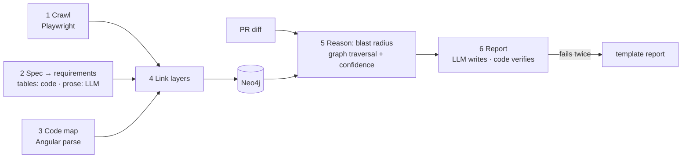

# Blast radius: design document

**Nekender Shekhawat · Testsigma AI Engineer assignment · November 2026**

## 0. What I built, in one page

An agent that answers one question for a QA lead: **"what could this pull request break, and how sure are you?"**

It works on [Conduit](https://demo.realworld.show), the RealWorld demo app (Angular frontend), because it is the rare
public app with all three layers available and tied together: a live deployment, the
[source repo](https://github.com/realworld-apps/angular-realworld-example-app) that deploys it, and a public spec that
**enumerates** what the app must contain (the [frontend spec](https://docs.realworld.show/specifications/frontend/routing/)
plus an E2E [selectors contract](https://github.com/realworld-apps/realworld/blob/main/specs/e2e/SELECTORS.md)). An
enumerated spec matters: you can only claim something is *absent* if you know what should be there.

| Layer | Source | What the graph holds today |
|---|---|---|
| Requirements | spec tables (parsed by code) + routing prose (LLM) | 106 requirements: 92 covered, 14 unknown, 5 flagged "partly present" |
| UI | Playwright crawl, logged out and logged in, dry-run clicks | 14 screens, 206 elements, 10 flows (8 observed, 2 only in code) |
| Code | Angular-aware parse of the repo at any commit | 11 routes, every component method with line ranges, 24 service endpoints |
| Code ↔ UI | scored matching + an independent API-call check | 171 of 206 elements linked to the template that renders them |

**Sample output:** [`reports/pr-311.md`](../reports/pr-311.md). PR #311 changes how the editor saves an article. The
report says: re-test publishing a new article (seen in the app, high confidence); re-test editing an existing article
(medium confidence, *never seen in the app*, because the crawler never owned an article); and the requirement "the app
updates an article with PUT" has no UI coverage to re-check it with.

**Where I went deep:** the **code ↔ UI link** (it is what makes a PR traceable to anything a QA lead cares about) and
**requirements ↔ UI including absence** (what the brief singles out). **Where I scoped down:** crawl breadth (no
exploration of states that need writes), code parsing (regex + HTML parser, Angular only, not a TypeScript AST), and
one framework. Section 5 defends each cut.

**Evals:** on two hand-labelled PRs, the deterministic stages give byte-identical output across runs, recall is 1.0
on both, and every LLM-written report passed verification (5/5 and 3/3 runs). Section 4 explains why those numbers are
weaker evidence than they look, and what I'd do about it.

## 1. Agent decomposition

Six stages. The rule I used to draw every boundary: **the LLM is used where the input is prose and the output is
checkable; everything that can be computed is computed.** The model proposes, code verifies, and nothing the model
says reaches the graph or the report unchecked.



| Stage | Deterministic or LLM | Why |
|---|---|---|
| 1 Crawl | Deterministic | The crawl is the ground everything stands on. If it changes run to run, nothing downstream is reproducible, and you can't eval it. |
| 2 Spec | Tables by code, prose by LLM | SELECTORS.md is already tables (89 requirements): paying a model to read a table adds variance and cost for nothing. routing.md is prose bullets: the LLM turns each into a requirement **with the UI evidence that would prove it** (texts, input names, classes, API calls). Output is schema-constrained. |
| 3 Code map | Deterministic | Routes, methods and bindings are facts in the source. An LLM reading code would be slower and occasionally wrong about line ranges, which is exactly what diff mapping needs. |
| 4 Link | Deterministic scoring; LLM only as a judge for requirements with no checkable evidence | Matching a crawled button to its template is a scoring problem with good features. The judge is used only when a requirement is pure behaviour, its answer must cite element ids that exist, and it's capped at 0.8 confidence. |
| 5 Reason | Deterministic | Diff → methods → graph traversal → scores. This is where trust matters most, so it's the part with no model in it. |
| 6 Report | LLM writes, code verifies | A non-engineer needs prose. The model only sees the facts from stage 5, every bullet must cite fact ids, and a verifier rejects invented ids and checks every high-confidence item is mentioned. One rewrite, then a template fallback. |

**Why this is an agent and not a prompt chain.** The stages hold state across each other and make decisions in code:
the crawler decides what counts as the same screen; the linker decides absent vs unknown from where it looked; the
reasoner decides what's at risk from graph structure and confidence; the report loop branches on verification. Both
pipelines are LangGraph graphs (`pipeline.py`): the spec and code stages run in parallel, and *write → verify →
rewrite once → fall back* is an explicit conditional edge, not a retry buried in a function. LangGraph earns its place
here for named, typed stages and that loop; I didn't need its memory or agent-loop features.

**Two crawler decisions worth defending:**

- **Dry-run clicks.** Every button is clicked with all non-GET API calls intercepted and aborted. We learn that
  *Publish Article* calls `POST /api/articles` without writing anything to a live public app. That observed call
  becomes an independent signal for the code link (stage 4) and for API requirements.
- **State identity = route template + login state.** Templates are learned from URLs: a path position that takes
  several values (slugs, usernames, tags) becomes `:p`. Each template is visited at most twice. 500 articles become
  one screen, not 500. A structure hash is stored per screen for the next step (detecting two visually different
  states on one URL), which I didn't need for this app.

## 2. Graph schema, and why

```
Requirements  (Requirement)-[:COVERED_BY {confidence, method, evidence}]->(Element | Screen)
              (Requirement)-[:HAS_GAP]->(Gap {status, reason})-[:SEARCHED]->(Screen)
              (Requirement)-[:EXPECTS_API]->(Endpoint)
UI            (Screen)-[:HAS]->(Element)-[:NAVIGATES_TO]->(Screen)
              (Element)-[:CALLS {observed}]->(Endpoint)      (Screen)-[:LOADS]->(Endpoint)
              (Flow)-[:STEP {order}]->(Screen | Element | TemplateElement)
Code          (File)-[:DEFINES]->(Component)-[:HAS_METHOD]->(Method)-[:CALLS_API]->(Endpoint)
              (Component)-[:HAS_TEMPLATE]->(TemplateElement)
              (Method)-[:AFFECTS {why}]->(TemplateElement)
Code ↔ UI     (TemplateElement)-[:RENDERS {confidence, method, evidence}]->(Element)
              (Screen)-[:SERVED_BY]->(Component)
```

**Justified against the query I actually run.** The blast radius is one traversal:

> changed `Method` → `AFFECTS` → `TemplateElement` → `RENDERS` → `Element` ← `HAS` ← `Screen`;
> then `Flow`s with a `STEP` on those elements; then `Requirement`s whose `COVERED_BY` points at them.

Each schema choice exists because that query needs it:

1. **`TemplateElement` is its own node, between `Method` and `Element`.** A method doesn't render anything. It is
   bound to template elements (`(click)="submitForm()"`), and template elements render into the live DOM. Collapsing
   either hop loses the thing you need to explain *why* a button is at risk ("bound to `submitForm()`; matched on
   screen by text and by the API call it made").
2. **`Endpoint` is shared by all three layers.** The code calls it (`CALLS_API`), the UI was seen calling it
   (`CALLS`), the spec expects it (`EXPECTS_API`). That gives a second path from a change to a requirement that
   doesn't depend on the crawl. It is how PR #311 reaches "the app updates articles with PUT" even though no crawled
   button ever made that call.
3. **Confidence lives on edges, not nodes.** A button isn't uncertain; the *link* from a template to it is. Path
   confidence = product of edge confidences; an item keeps its best path.
4. **`Flow` points at both `Element` and `TemplateElement`,** so a flow known only from code (the edit-article flow,
   never reachable by the crawler) still joins the traversal.

### Absence

The brief asks how to model requirements that should be testable but aren't in the UI. **Absence is a node, not a
missing edge.** "No `COVERED_BY` edge" can't distinguish *absent* from *we never looked*. A `Gap` records where we
looked (`SEARCHED` edges to screens, with their login state) and a status:

| Status | Meaning | Example from this app |
|---|---|---|
| `absent` | Crawled the right page in a state that should show it; nothing matched; **not in the code either** | none on this app (see below) |
| `unknown` | Never reached the right page in the needed state, *or* it exists in code behind a condition the crawl never met | "Delete Article" is in `article.component.html:37` under `@if (canModify())`: the crawler never owned an article |
| `unknown` (write-gated) | Code can make the call, but the triggering state needs a prior write the dry run blocks | "Unfollow" needs a user you already follow |
| partly present | Some of the requirement's evidence pieces found, others missing | below |

The *code* is what turns a naive "absent" into a correct "unknown". My first version reported 7 requirements as
absent; checking each one by hand showed all 7 were wrong: 2 were a crawler bug (three inputs in identical fieldsets
merged into one element), 3 were a spec-parser bug (two tables both titled "Buttons"), and 2 were API calls whose
triggering state needs a prior write (unfavourite, unfollow). So the rule became: **claim absence only with three facts: the page was crawled, it was
crawled in a state that should show it, and the code doesn't have it.**

**Partial presence found real spec drift.** Requirement evidence is checked piece by piece (each text, name,
placeholder, class), and confidence scales with the share found. That surfaced three genuine differences between the
spec and the live app, all confirmed in the source:

- Profile tabs say **"My Posts / Favorited Posts"**; the spec says "My Articles / Favorited Articles".
- The settings field placeholder is **"Username"**; the spec says "Your Name".
- The home banner's spec tagline **"A place to share your knowledge."** has been replaced by a demo notice.

None of these are bugs a QA lead would catch from a green test run. They are exactly the "spec says, UI doesn't"
gaps the absence model is for.

## 3. Confidence under ambiguity

Confidence is a number on every link and every impact, with two thresholds: **≥ 0.75 accept**, **0.45–0.75 keep
but flag**, **< 0.45 drop or review**. Every number comes with the evidence that produced it, in words.

**Where the numbers come from (code ↔ UI):** a crawled element is scored only against template elements of
components actually rendered on that screen (route → page component → its children, plus the layout). Features:
`name` attribute (+0.6), placeholder (+0.6), exact text (+0.5) or prefix (+0.3), routerLink = href (+0.4), tag,
class overlap, sitting inside the component's root block in the DOM (+0.15), `@if` condition consistent with the
login state (+0.15), and **the dry-run API call matching what the bound handler can reach (+0.5)**, which is an
independent channel that a coincidental text match can't fake.

**What happens in the cases the brief names:**

1. **The PRD describes a feature I can't find in the UI.** It becomes a `Gap`. If the page was never reached in the
   right state, or the code has it under a condition, it's `unknown` with the reason; the report says "never seen
   in the running app" instead of guessing. It only becomes `absent` with the three facts above.
2. **The code change touches a function I can't map to UI.** Three sub-cases, all reported, none dropped:
   - The function reaches the UI only through state the crawl never saw → the item is reported as "in code, not
     observed" at reduced confidence (×0.5 for elements, ×0.7 for endpoints).
   - The file was renamed since the PR → **lineage**: the agent follows git renames forward (similarity ≥ 20%). PR
     #268's `show-authed.directive.ts` went through three renames to `core/auth/if-authenticated.directive.ts`; the
     agent follows the chain, says so in the report, and multiplies confidence by 0.7.
   - Nothing matches at all → listed under "Needs a person" with the file and lines.
3. **Two template elements explain one UI element equally well.** If they're copies with the same effect (the same
   "Home" link in two `@if` branches of one component), both are linked: which one rendered doesn't change what a
   code change can break. If they differ (a header "Sign in" link vs the article page's "Sign in to comment"), both
   are kept at 0.8× and the pair goes to review. That rule cut review items from 74 to 22 without hiding a real one.

**When does it stop and ask a human?** It never blocks. It always produces a report, and puts anything uncertain in
a "Needs a person" section with the reason: never observed, low confidence, ambiguous link, unmapped code. The
design choice is that a QA lead would rather get a report on time with honest gaps than wait. In a CI setting the
same list could gate the merge (fail if a high-risk item is unobserved), which is a one-line policy, not a redesign.

## 4. Eval approach

**"If we ran your system 100 times, how would we know which runs were correct?"** Split the system by what can vary.

1. **Deterministic stages must not vary at all.** The eval hashes the full impact set (kind, id, confidence) per run.
   Any difference between runs is a bug, not noise. Result: identical hash across all runs for both PRs.
2. **Correctness against a gold set.** `evals/gold/pr-<n>.json` holds hand-labelled `must`, `acceptable` and
   `must_not` items (matched on kind + label + page, not on ids, so labels survive a rebuild).
   - recall = share of `must` items found; precision = share of reported items that are `must` or `acceptable`.
   - any `must_not` hit (e.g. anything on `/settings` for an editor change) fails the run.
3. **The LLM stage varies, so it's checked by rules, not by eye.** Each run regenerates the report with the cache
   off, and the verifier checks: no cited id that isn't in the facts, every high-confidence item mentioned.
4. **A run is correct** when recall = 1, no `must_not` hits, and the report passes. **pass^k** (all k runs correct) is
   the bar, not pass@k: a QA lead sees one report, so one bad run in five is a bad tool.

| PR | Runs | Deterministic identical | Recall | Precision | Report pass rate | pass^k |
|---|---|---|---|---|---|---|
| #311 (editor save) | 5 | yes | 1.0 | 1.0 | 5/5 | yes |
| #268 (editor + login directive) | 3 | yes | 1.0 | 1.0 | 3/3 | yes |

**Why this is weaker than it looks, honestly:**

- **Two PRs, labelled by me, one of them while I was tuning.** #311's gold set was written alongside development, so
  a 1.0 there is partly fitting. #268 was the held-out check and it *failed* first time: it missed the whole
  login-directive blast radius because of the file rename. That failure is why lineage and directive subtrees exist.
  The gold labels for #268 come from the diff and `git grep`, but I'd want a second labeller.
- **#268's `acceptable` list is broad,** so its precision of 1.0 says little. A tighter gold set would show the
  medium-confidence page-level requirements (routes on affected pages) as noise.
- **The spec stage isn't in the loop.** The eval reuses one graph build. LLM variance in requirement extraction
  would show up as different requirement sets; the next eval is N builds, comparing requirement sets and evidence.

**What I'd build next for evals:** label 20 PRs (the repo's history has enough), and use the RealWorld project's own
Playwright E2E suite as an independent oracle. Run it at the PR's parent and merge commits; tests that change outcome
or touch changed selectors are ground truth for "at risk", labelled by someone other than me.

## 5. Scope decisions

**Went deep:**

- **Code ↔ UI at method granularity, with two independent signals.** This is the hard, valuable part: without it,
  "which UI is at risk" is a guess from file names. The dry-run API cross-check is the piece I'm proudest of: it turns
  a text match into a corroborated link.
- **Absence as evidence.** Three statuses, `SEARCHED` edges, piece-level partial matching, and the code as a check
  against false "absent". This found real spec drift on a public reference app.
- **Diff → code at the PR's own commit, then carried to today's code** by selector, name, and git rename lineage, so
  old PRs work against a moved codebase.

**Scoped down, and why:**

| Cut | Why | Cost | Next |
|---|---|---|---|
| No states that need writes (owning an article, following someone) | A crawler that writes to a public demo creates data, can't be re-run cleanly, and needs cleanup. I chose a reproducible, harmless crawl. | Edit/delete/unfollow flows are "unknown". #311's main risk is in that blind spot. The report says so. | A seeded state: create one article via the API before the crawl, delete it after, with the account the crawler already has. |
| Regex + HTML parser, Angular only | 63 files, one framework: this got method-level precision in a few hours. | Misses unusual TS syntax; another framework needs another parser. | tree-sitter for TS/TSX, with a per-framework "binding extractor" (Angular templates, JSX handlers, Vue). |
| Crawl budget: 2 instances per template, ~40 pages, no pagination | The app has 13 page types; more instances add little. | Rare variants of a page (an article with no comments) aren't seen. | Structure hash to detect state variants within a template, visited until no new structure appears. |
| LLM only on spec prose, judge and report | Variance and cost where they buy nothing. | Can't match synonyms ("Your Name" vs "Username"): those show as partial, which is arguably right. | Embedding match as a third, weaker signal, flagged as such. |
| One app | Depth over breadth, as the brief asks. | Untested on other apps. | Saleor storefront (Next.js) is the next target; checked, viable. |

## 6. With another week, in order

1. **Seeded states for the crawl** (2 days). Create an owned article and a followed user via the API before crawling,
   tear down after. This closes the biggest blind spot: #311's edit flow would move from "never observed" to
   observed, and the four owner-only requirements from unknown to checkable. Highest value because the riskiest
   flows in most apps are the ones behind ownership.
2. **An independent eval oracle** (2 days). Run RealWorld's Playwright suite at each PR's parent and merge commit and
   use outcome changes as labels. This replaces "labelled by the person who built it" with evidence, and gives a
   20-PR benchmark to tune thresholds on instead of two.
3. **tree-sitter code layer + a second framework** (3 days). Removes the regex fragility and proves the schema isn't
   Angular-shaped: only the binding extractor should change. Saleor's Next.js storefront is the test.

I'd do them in that order because 1 fixes what users see, 2 makes every later change measurable, and 3 is
generalisation, which only pays once 1 and 2 show the core is right.

## Appendix: how this maps to Testsigma

- **Coverage:** requirement ↔ UI with `absent / unknown / partial` is coverage analysis that knows the difference
  between "not built" and "not tested yet".
- **Healer:** the code ↔ UI scoring (multiple signals, state fit, DOM ancestry, a corroborating API call) is the same
  problem as re-finding an element after a UI change, run in the other direction.
- **Impact analysis before Gen/Executor:** the blast radius tells you which tests to run or regenerate for a PR,
  rather than running everything.
